I'd had this little box lying around for a long time — an HP t610 Plus thin client. I originally got it as a gift idea for a friend, but first I was missing parts, then I killed the motherboard. The project gathered dust for a long while — and at some point I grew to like it myself. So it stayed with me as a retro machine.

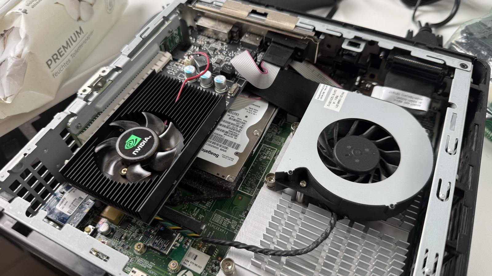

| | HP t610 Plus |
|---|---|
| CPU | AMD G-T56N — 2 cores, Bobcat, 1.65 GHz |
| GPU | integrated Radeon HD 6320 + GeForce GT 730 2 GB DDR3, 64-bit |
| RAM | 8 GB DDR3 |
| storage | IDE DOM 2 GB, SATA DOM 16 GB, SSHD 500 GB |
| slot | 1× PCIe x16, full-length, but single-slot cards only |
| ports | COM, LPT, DVI (VGA via a passive adapter), PS/2, <del>mobile-style IDE</del> |

What makes it good for retro: a real PCIe slot, COM and LPT, PS/2 for mouse and keyboard, a compact and nice case. It's more powerful than all my other retro machines, though not very powerful on its own: the CPU is dual-core, sort of, but meh. And it's hard to call it a retro machine anyway: it's basically a small early-2010s mini-PC — the t610 came out in 2011. An important addition is the discrete graphics card. The GT 730 may be pretty mediocre, but it's a separate card, and it has official drivers for XP and 7. The idea: Windows 98, XP and 7 on one box, to run games and programs that don't work properly on modern hardware.

And one evening in September I felt like tinkering with something. The plan was simple: calmly install 98 on the 2 GB DOM, then just as calmly XP on the HDD. How wrong I was.

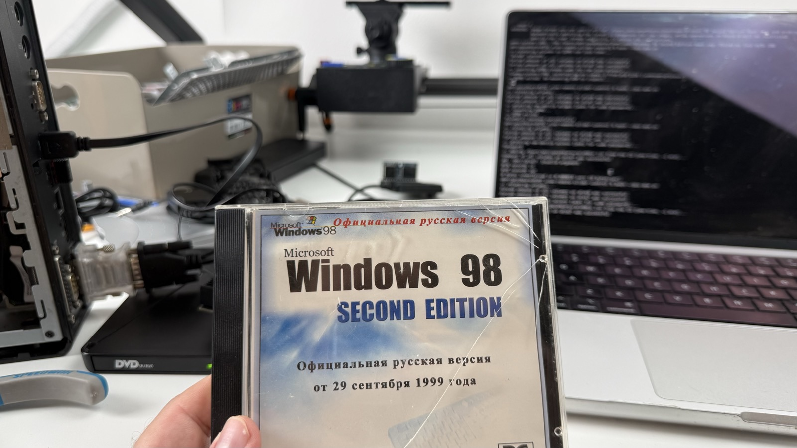

## The IDE DOM that wouldn't boot

I started by formatting the 2 GB DOM as FAT32 right on the Mac. Result:

```
Error loading operating system
```

What didn't help:

```
FDISK /MBR
SYS C:
FORMAT C: /S
BIOS: translation Auto / LBA Assisted
```

Disconnecting all other drives didn't help either. I also tried a small partition at the start of the disk — size wasn't the issue.

Only FAT16 + MS-DOS 6.22 worked — then the DOM booted right away.

By the way, this error isn't printed by DOS yet, but by the MBR boot code: it found the partition but couldn't read its first sector through the BIOS.

### The IDE connector that isn't really IDE

Another important thing I figured out along the way: the 44-pin "IDE" connector on the t610 is most likely not IDE at all, but a SATA port with a SATA↔PATA bridge. I found no direct confirmation, such as the specific bridge chip, but everything adds up:

- the BIOS labels the DOM as SATA0;
- there's only one disk controller in the system — SATA ([lspci on parkytowers](https://www.parkytowers.me.uk/thin/hp/t610/));
- the working Windows 98 has no IDE controller at all, and the "IDE" DOM with the system is served by a SATA AHCI driver (more on that below);
- the DOS utility `IDEINFO` doesn't see the disk on the IDE ports, even though the computer boots from it just fine via the BIOS.

Hence all the weirdness in DOS.

### A bit of theory: how DOS works with a disk

DOS has no disk drivers of its own. All reads and writes go to the BIOS through the `INT 13h` interrupt: "give me sector such-and-such", and it's the BIOS that knows how to talk to the controller. The sector is addressed by CHS — cylinder, head, sector — and the BIOS translates that into a real address on the disk. If the BIOS made up one geometry for the disk and the boot loader expects another, the wrong sector gets read — hence "Error loading operating system".

It's slow because every small chunk of data is a separate call, and the CPU just sits and waits for the answer. Normally Windows 98 doesn't do this after boot: it loads its own 32-bit driver (for IDE that's `esdi_506.pdr`, in my case it ended up being `AHCI.PDR`) and talks to the controller directly. If the driver doesn't load, 98 falls back to MS-DOS compatibility mode and goes through the BIOS again — slow and sad.

<iframe width="560" height="315" src="https://www.youtube.com/embed/Zo9ZfnYCDAo" title="YouTube video player" frameborder="0" allow="accelerometer; autoplay; clipboard-write; encrypted-media; gyroscope; picture-in-picture; web-share" referrerpolicy="strict-origin-when-cross-origin" allowfullscreen style="width:100%;height:auto;aspect-ratio:16/9"></iframe>

## DOS pitfalls

At first I decided to work with the DOM from the Mac via a USB adapter. I thought I'd quickly run the install, or at least part of it, in a VM, and then finish setting everything up on the real machine. Wrong again.

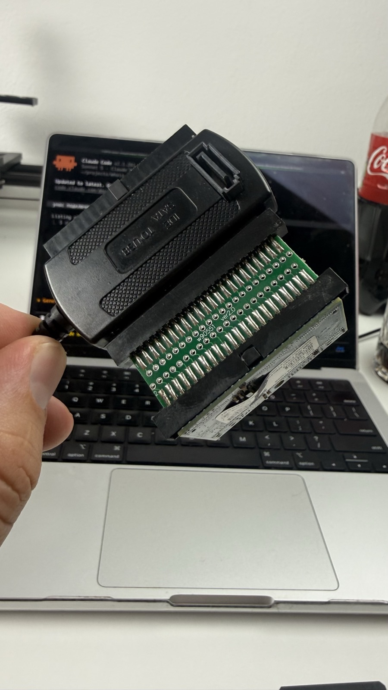

And I immediately stepped on the first rake: I attached the DOM to QEMU as is, to partition it and start the install — and QEMU corrupted its partition table. After that I only worked with an image: dump the DOM to a file, run QEMU with it, then write it back to the DOM.

```bash
diskutil list                      # re-check the disk number every time
diskutil unmountDisk /dev/diskN
sudo dd if=/dev/rdiskN of=dom-backup.img bs=4m
shasum -a 256 dom-backup.img
```

Next:

- The install wouldn't go from the boot floppy that came with 98. Its system files (including a suspiciously small `MSDOS.SYS`) wouldn't boot even in QEMU, and `sys` and `xcopy` simply weren't on it. So first I tried installing DOS from MS-DOS 6.22 floppies — that went fine. In the end I built my own boot floppy — on DOS from a full Windows 98 SE (MS-DOS 7.1), with the utilities I needed: `FDISK`, `FORMAT`, `SYS`, `XCOPY`, `SMARTDRV`, `SCANDISK`, `PATCH9X`, `AHCILDR` and others. It finds the distribution on the disks by itself and starts the install.

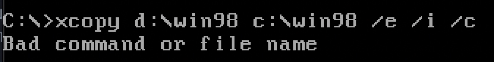

- **The USB drive kept dropping out.** In the end I put the distribution on the second disk — a SATA DOM with a FAT16 partition WIN98XFER — and installed from there. And plain `copy` instead of `xcopy` ran into:

```
CDR101: Not ready reading drive D
```

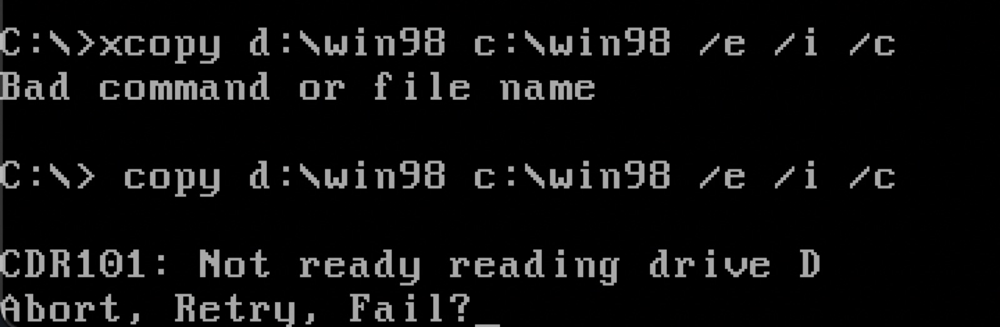

- **FDISK on the wrong disk.** While several drives were connected, the numbering in `FDISK` kept shifting, and once I spent a long and thoughtful time partitioning an 18 GB disk instead of the DOM. Most likely it was the 500 GB SSHD, which `FDISK` saw as 18 GB. Takeaway: only one disk connected when partitioning.
- **`FDISK` checked the disk for over an hour. Twice.** `Verifying drive integrity` ran at about 0.4 MB/s: 77% in an hour. The DOM isn't to blame — it's DOS reading it through the BIOS in small chunks. Then `FDISK` asked "use the whole disk for the primary partition and make it active?", I said "yes" — and it started checking all over again. Another hour.

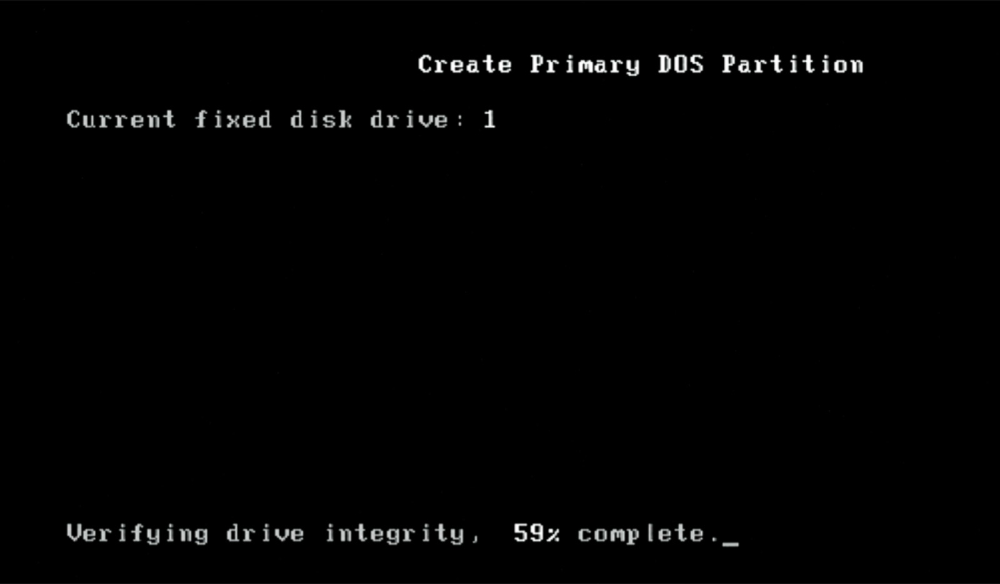

- **Random fixes.** Batch files and advice from LLMs, random fixes from the internet — every now and then all of that led to a picture like this:

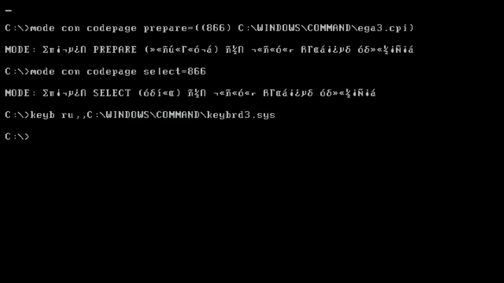

And at the last stage of the install, the text in the window turned into gibberish — Russian CP1251 was drawn with the Central European CP1250 font, "Программы" looked like Ďđîăđáěěű. It didn't affect the install. Normally this screen looks like this:

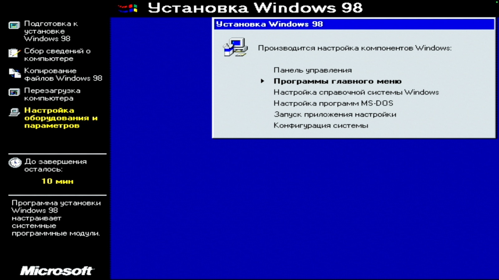

- **The product key** suddenly typed in the Russian layout. I spent a long time wondering what to do and didn't understand how to enter it at all. Supposedly the layout is switched with <kbd>Ctrl+Alt+F1</kbd> — US, <kbd>Ctrl+Alt+F2</kbd> — RU, but for some reason it didn't work for me. Most likely it's down to my peculiar keyboards, which don't handle these combinations quite right. In the end I just put the key into the answer file.

In general, to make the install simpler and faster, I put together my own kit for the t610: an answer file for Setup (`MSBATCH.INF` — with it Setup runs without questions) and a set of prepared configs, and everything was launched with a single `INSTALL.BAT`. I've posted both files: [INSTALL.BAT](../../files/articles/hp-t610-win98/install-bat.txt), [MSBATCH.INF](../../files/articles/hp-t610-win98/msbatch-inf.txt) (product key replaced).

## 8 GB of RAM

The files copied, DOS works, but the GUI won't start: "Insufficient memory to initialize Windows" or like this:

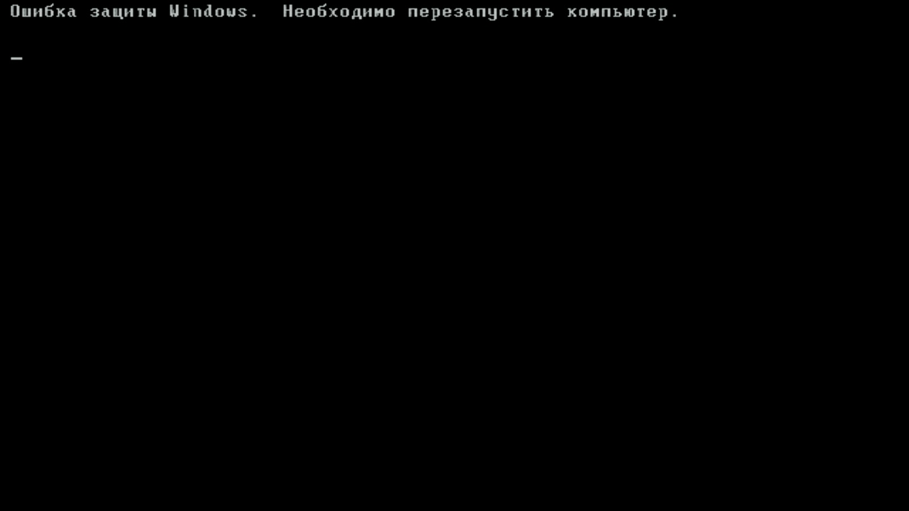

Windows 98 isn't designed for 8 GB. I didn't want to pull the sticks, and there's no point anyway: DDR3 sticks of a size suitable for 98 simply don't exist.

For scale: Windows 98's minimum requirement was 16 MB of RAM. Back then a computer with 16 MB, or even less, was perfectly normal. New ones in 1998–1999 were already sold with 32–64 MB, gaming ones with 64–128 MB, and by the start of the new millennium 128–256 MB became the norm for a new computer. 98 itself runs fine up to about 512 MB. Beyond that the disk cache starts acting up, and past ~1 GB the system may not start at all — Microsoft even officially acknowledged this. The theoretical limit for a 32-bit system is 4 GB of address space, but 98 runs into problems much earlier. And here we have 8 GB — 500 times the minimum requirement.

What I tried:

- `MaxPhysPage=20000` and `MaxFileCache=65536` in `SYSTEM.INI` — partial progress, but not a solution;
- `HIMEM.SYS /MAX=` — bad advice, MS-DOS `HIMEM` simply has no such switch;
- `HIMEMX` with `/MAX=` — DOS is happy, Windows still hangs. Limiting memory for DOS isn't the same as fixing the Windows memory manager.

What helped was **PATCHMEM 7.2 by R. Loew** ([documentation](https://github.com/JHRobotics/patcher9x/blob/main/doc/patchmem-manual.txt)). It patches `VMM.VXD` and `VCACHE.VXD`. I checked that the patch actually applied: this string appeared inside `VMM.VXD`:

```
Windows 9X RAM Limitation Patch 7.2
```

After that memory stopped being a problem — and the boot failed at the next step.

## The disk in protected mode: esdi_506 and AHCI

Next stop — `BOOTLOG.TXT` ended with the same line every time:

```text
Initing esdi_506.pdr
```

That's the stock IDE driver in Windows 98, and on the t610 it hangs the system. Even earlier, hardware detection had hung on the USB controller; the second pass got past it.

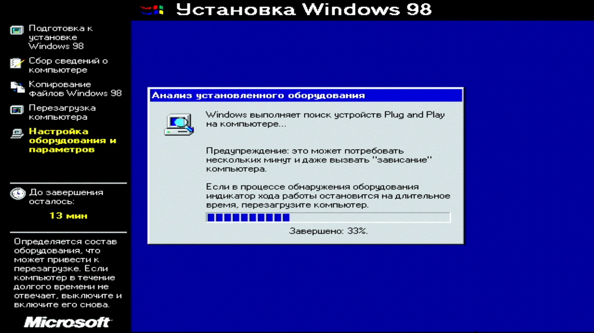

The solution — **an AHCI driver by the same R. Loew**. SATA mode in the BIOS — AHCI, and finally in the log:

```text
Initing ahci.pdr
Init Success ahci.pdr
INITCOMPLETESUCCESS = AHCI
```

I added the driver to the already installed Windows: put the files on the DOM in `C:\DRV\AHCI` and installed it from there via the INF.

### Which driver to look for

I can't post the driver — the license explicitly forbids redistribution. But here's everything you need to find exactly this one:

- **Windows 95/98/98SE/ME AHCI Driver 3.0**, Rudolph R. Loew (RLoew), 27.07.2019. Search the MSFN forum for `rloew AHCI driver`, `AHCI.PDR`.
- The driver binds to the AHCI controller class, so it'll work on more than just the t610.
- I installed `AHCI4.INF` — for 4 ports.
- It's installed correctly if Device Manager shows `Standard 4-Port PCI AHCI Controller` with `AHCI Port 0…3` under it.

```
t610 controller:  PCI\VEN_1002&DEV_4391&SUBSYS_17E2103C&REV_40
Class in INF:     PCI\CC_0106

AHCI.ZIP:  AHCI.PDR, AHCI4.INF, AHCI6.INF, AHCILDR.COM, AHCIMAP.COM

AHCI.ZIP  MD5 0340dcbe415e97e28aa1b090c50463bc
AHCI.PDR  24,912 bytes, MD5 0f7ff4b3aeff131ff3e292184a68fca7
```

Log of a successful boot: [bootlog-ahci-ok.txt](../../files/articles/hp-t610-win98/bootlog-ahci-ok.txt)

## Video

The next barrier:

```text
Starting Стандартный видеоадаптер PCI (VGA) (PCI\VEN_1002&DEV_9806...)
VDD: Cant start theVGA, after init complete.
```

Windows wouldn't go any further; only safe mode at 640×480 and 16 colors worked.

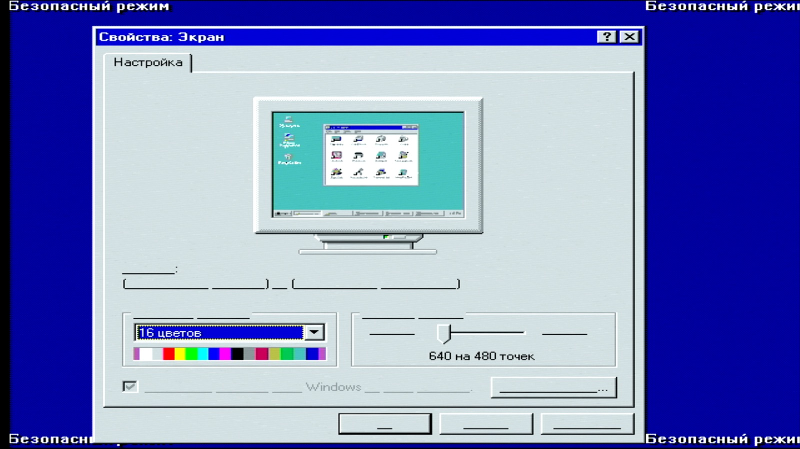

Along the way I also got a blue screen with fatal exception 06:

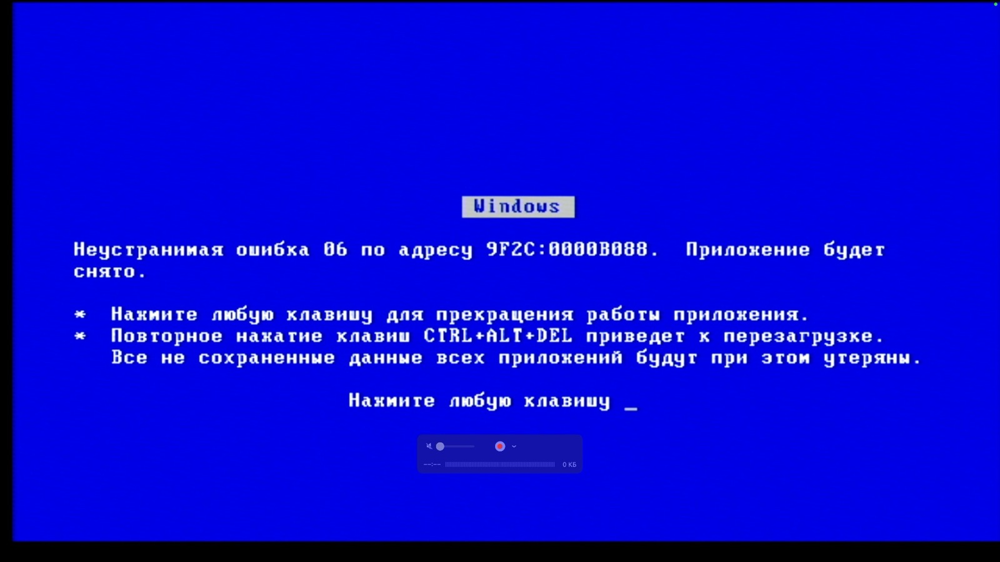

And the cure was a single line in `C:\WINDOWS\SYSTEM.INI`:

```ini
; before
display.drv=pnpdrvr.drv
; after
display.drv=vga.drv
```

The DOM backup after the first successful boot differs from the failed one by exactly this line. Log: [bootlog-vdd-cant-start-vga.txt](../../files/articles/hp-t610-win98/bootlog-vdd-cant-start-vga.txt), working [SYSTEM.INI](../../files/articles/hp-t610-win98/system-ini-working.txt).

There's no 98 driver for the integrated Radeon HD 6320. And there can't be: the last Radeon drivers supporting Windows 98 came out back when Radeon was made by ATI, not AMD. High resolutions and color came from the universal **[VBEMP](https://bearwindows.zcm.com.au/vbe9x.htm)** via VESA — the "VBE Miniport (ATI/AMD)" variant. No hardware acceleration with it.

VBEMP is a universal video driver for Windows 9x. It knows nothing about the specific card and works through VESA BIOS Extensions — a standard video BIOS interface that almost every card has. The driver asks the video BIOS to switch to the right mode and then just draws into the framebuffer: you get resolution and color, but no acceleration. For hardware with no native 98 drivers, it's often the only option.

### GT 730 and X700

I put in the GT 730 hoping for fewer problems: it's a proper discrete card after all, no quirks with the chipset and CPU. At first the picture still came from the integrated Radeon, and the GT 730 outputs were blank — I couldn't find a primary display switch in the BIOS. The image on the GT 730 appeared **only after installing VBEMP**, and only on **DVI**: POST and BIOS still aren't visible on it, and nothing ever showed up on HDMI. The GT 730 has no native 98 driver.

The logical move — get a card from that era with a native 98 driver. I bought an **[ATI Radeon X700 PRO](https://www.ebay.com/itm/188346376334)** with 256 MB GDDR3: the driver installed and works, but I haven't pushed it much yet — games and 3D are still ahead.

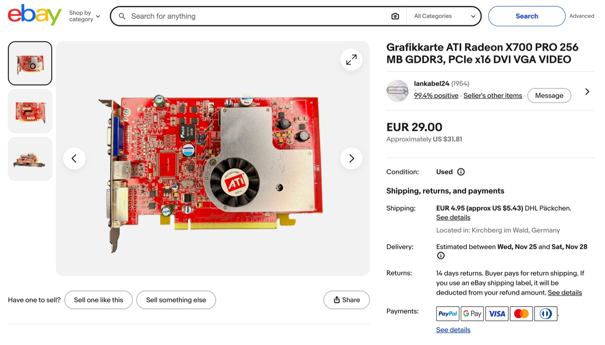

## The mouse incident

At some point after the install the mouse started working terribly: the cursor would jerk, then jump, and it was impossible to aim at anything precisely. I tried everything I had at hand:

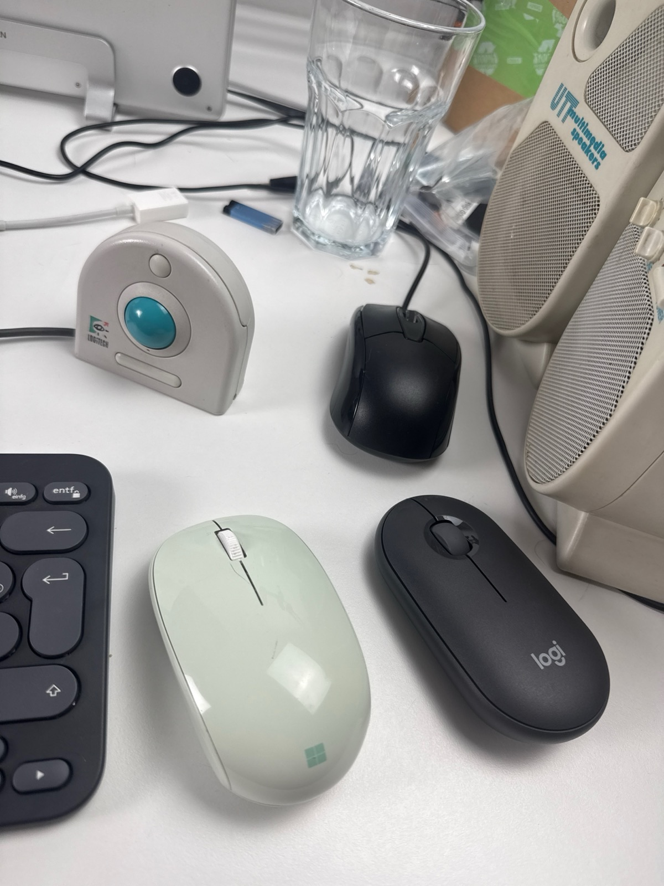

In the end everything started working fine after the computer sat overnight. I never found the cause.

## What never worked in 98

- **Sound.** The built-in HD Audio isn't supported in 98. SBEMU gives sound only in pure DOS. I also tried a Covox — the simplest DAC made of a handful of resistors, dating back to the late 80s. Mine is home-soldered and fits entirely inside an LPT plug. It did play the Windows 98 startup sound through the speakers, but I couldn't get it working for multimedia beyond that: Media Player says "no suitable device found".
- **Network.** At first I decided it was a Realtek card and ran the DOS driver `RTLPKT` — got an all-zeros MAC. By PCI ID it turned out to be a Broadcom BCM57781 (`14E4:16B1`). Takeaway: ID first, then the driver.
- **Wi-Fi.** 98 sees the MT7601U USB dongle (`148F:7601`), but there's no driver for it.

<figure><div class="video-round" onclick="var v=this.firstChild;v.paused?v.play():v.pause()"><video src="../../files/articles/hp-t610-win98/covox.mp4#t=0.1" playsinline preload="metadata" onplay="this.parentNode.classList.add('playing')" onpause="this.parentNode.classList.remove('playing')"></video></div><figcaption>Covox on LPT: the Windows 98 startup sound</figcaption></figure>

## Windows XP

After 98, XP is almost a vacation. Not everything is simple there either, but it's much simpler and calmer.

### The disk in AHCI and an F6 nobody responds to

Same problem as with 98: the SATA controller runs in AHCI mode, XP has no AHCI driver of its own, and the installer simply doesn't see the disk. The driver has to be slipped in.

The classic way is to press <kbd>F6</kbd> at the start of the install and provide the driver from a floppy. My XP didn't react to <kbd>F6</kbd>. But when the installer said no disks were found, you could specify the driver manually: pick the floppy, pick the driver — and the disk appeared. This was done in menus that I think I was seeing for the first time in my life, but I didn't think to take photos of them.

I installed from an external USB floppy drive, and it was quite a dance: sometimes I had to eject the floppy and reinsert it until the installer picked it up. And the installer asked for the driver twice: after partitioning and copying files it for some reason wanted it again, and at that point it no longer saw the USB floppy.

The proper solution is to integrate the driver into the distribution, for example with nLite, and burn a new disc. By the way, the installer does see an external USB CD-ROM if you plug it into a USB 2.0 port. But I didn't feel like burning a new disc, and I didn't have a Windows computer at hand where I could calmly run nLite. It can surely be done with command-line tools on Linux or Mac too, but I'd had enough tinkering with 98.

### GRUB4DOS and XP from RAM

Instead, I remembered an old trick. In the early 2010s I did a bit of computer fixing for friends of friends. Windows 7 was already gaining popularity, but XP was still installed on weak machines, or sometimes just by request. I didn't want to carry discs around, and not every computer had a CD-ROM anymore. So I had a universal USB stick, and I installed XP from it via [GRUB4DOS](https://github.com/chenall/grub4dos).

**GRUB4DOS** is a boot loader that grew out of the old GRUB. Its main skill is disk emulation: it can take a floppy or ISO image file, load it entirely into RAM and present it to the BIOS as a real floppy drive or CD-ROM. Anything that boots afterwards and reads the disk through the BIOS can't tell the difference.

But there's a catch, familiar from the DOS chapter: XP works through the BIOS only at the very beginning of the install. As soon as its own kernel with its own disk drivers loads, the BIOS emulation is gone for it — and the virtual CD with it. That's what **FiraDisk** is for — a virtual disk driver for Windows 2000/XP/2003. It finds the images GRUB4DOS left in memory and presents them to Windows as regular disks, without the BIOS.

The gist: GRUB4DOS loads the XP ISO into RAM and attaches a virtual floppy with the FiraDisk driver next to it. The XP installer boots from the virtual CD, installs FiraDisk from the floppy and from then on doesn't lose the image, including across reboots. No CD-ROM, no nLite needed.

Here I simply put the AHCI driver on the same virtual floppy. It does two things at once: keeps XP in memory and works as an F6 floppy that doesn't disappear between reboots. And unlike the USB floppy, it definitely won't drop out.

There are four files on the stick: `grldr`, `menu.lst`, `XP.iso` and `firadisk.IMA`. The order is:

1. First boot — the menu entry with the text-mode phase of setup: partitioning, formatting, copying files.
2. After every reboot, until the desktop appears — the GUI-phase entry. It re-attaches the ISO and the floppy and boots the half-installed XP from the disk.
3. After that — a normal boot from the disk.

My files: [menu.lst](../../files/articles/hp-t610-win98/menu-lst.txt), [txtsetup.oem](../../files/articles/hp-t610-win98/txtsetup-oem.txt) — the description of the drivers on the floppy for the installer.

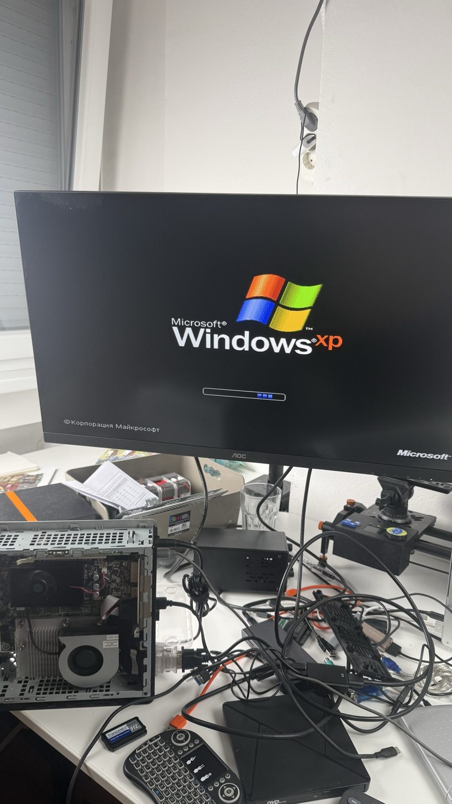

### Which AHCI driver to look for

- **AMD AHCI Compatible RAID Controller**, files `ahcix86.sys`, `ahcix86.inf`, `ahcix86.cat`, version 3.3.0250.41 dated 27.12.2012.
- It's in the AMD chipset driver package `AllIn1 8.86RC2` (folder `Packages\Drivers\SBDrv\hseries\RAID\XP`). Search by the file name `ahcix86.sys` and the controller ID.

```
t610 controller:  PCI\VEN_1002&DEV_4391&SUBSYS_17E2103C&REV_40
In txtsetup.oem:  PCI\VEN_1002&DEV_4391&CC_0106
```

### Drivers

In the end everything worked: network, sound, integrated graphics, GT 730. XP drivers for this hardware still exist, you just have to look for them. And some manufacturers stubbornly resist letting you download them: there were plenty of suitable drivers on their sites, but they either ask for a serial number or hide the files somewhere else. I don't know if they're that worried about load on their servers or what.

A separate note on the GT 730: NVIDIA released cards on different architectures under this name — Fermi (GF108) and Kepler (GK208), and the drivers for them differ. I got the worse version — a Kepler GK208 with a 64-bit bus and DDR3 — and the worse of the two drivers with it.

An interesting quirk: when I installed the X700 driver, the integrated graphics driver broke. Apparently the old ATI driver and the newer AMD one conflict, overlapping somewhere by ID. I haven't dug into it yet: after installing the X700 I haven't tinkered with the machine.

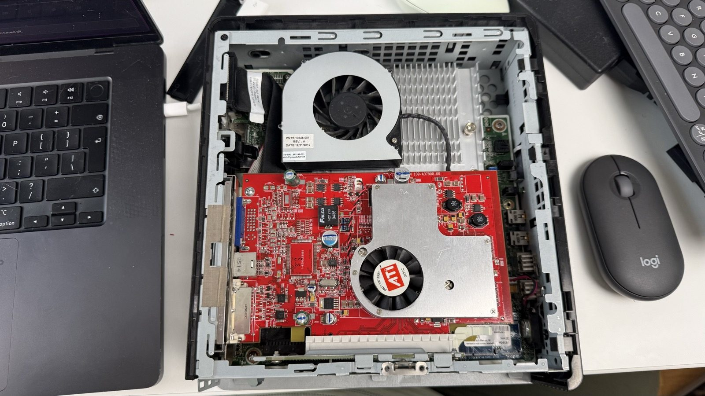

### Choosing the OS at boot

But I never fixed the 98 + XP boot. Each system lives on its own disk, and I pick the right disk in the BIOS every time. I expected XP to pick up 98 into its boot menu by itself, but no — probably exactly because it's on a different disk. The plan is a proper OS selection menu.

## Summary

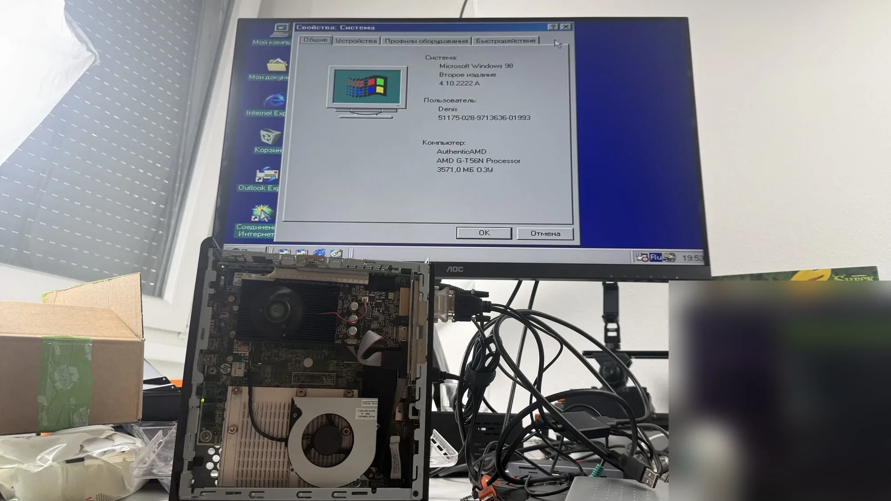

Windows 98 works on the t610: FAT16 on the DOM, PATCHMEM for 8 GB, `AHCI.PDR` instead of `esdi_506`, `vga.drv` → VBEMP, and an X700 in the slot. No sound and no network, but USB in 98 SE works great. XP next to it works fully, with all the drivers.

What I took away:

1. Win98 on the t610 is a fight with the hardware. If you just want games from 1998–2006, XP is easier. 98 here is for the process.
2. Problems come in a chain: boot → memory → disk → video → mouse. Fix one — hit the next. `BOOTLOG.TXT` shows where you are.
3. Disks — only via images and with a checksum.
4. Only one disk connected when partitioning.
5. PCI ID first, then the driver.
6. For 98 it's better to get a graphics card from that era than to torture a modern one via VESA.
7. Old tricks don't go away: the GRUB4DOS stick from the early 2010s came in handy again.

## Useful links

- [Windows 98 on thin clients — parkytowers](https://www.parkytowers.me.uk/thin/projects/win98.shtml)
- [HP t610 — parkytowers](https://www.parkytowers.me.uk/thin/hp/t610/)
- [PATCHMEM / patcher9x](https://github.com/JHRobotics/patcher9x)
- [VBEMP — universal VESA driver for Windows 9x](https://bearwindows.zcm.com.au/vbe9x.htm)
- [win98-mousefix](https://github.com/oerg866/win98-mousefix)
- [GRUB4DOS](https://github.com/chenall/grub4dos)
- [VOGONS: PCIe under Win98](https://www.vogons.org/viewtopic.php?t=44407)
